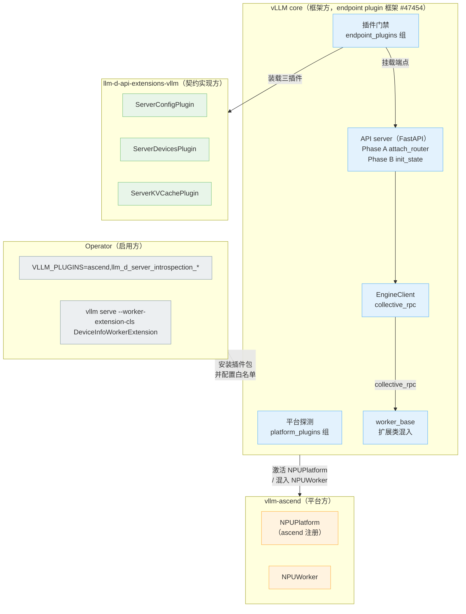
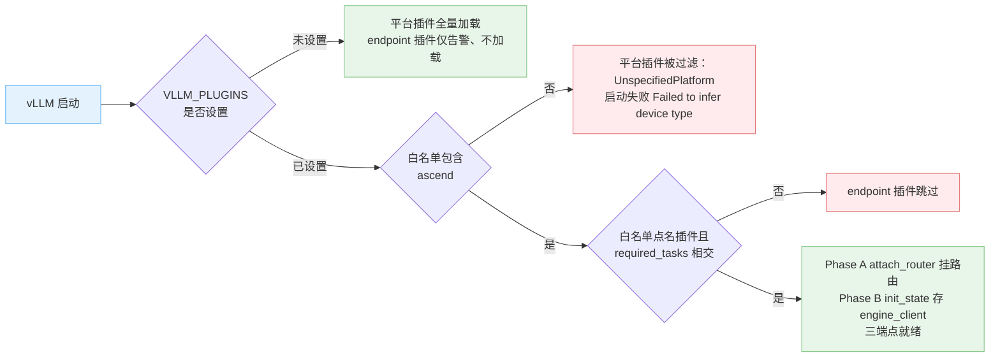
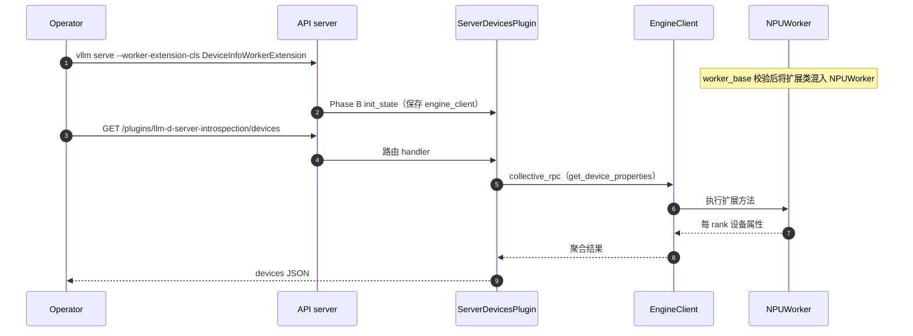

# vLLM 服务自省端点契约机制与 vllm-ascend 跟进方案

本文梳理 vLLM 上游 RFC [#38147](https://github.com/vllm-project/vllm/issues/38147)（Server Introspection 端点契约）的作用机制、当前状态与 vllm-ascend 的跟进方案。代码分析基于本地 vllm main（`1b95bc6c6b`，2026-11-02）与 vllm-ascend main（`426a26bc1`，2026-11-02），上游 main 与相关 PR 状态核对至 2026-11-02；NPU 实测数据引自同目录《RFC 38147（rollout sig）REPORT.md》（2026-10-27 快照）。

---

## 1. 背景

### 1.1 消费方与数据需求

llm-d 及同类推理服务路由/调度系统在实现 prefix-cache 感知路由、HMA 感知调度、DP endpoint 管理与负载调优时，依赖三类实例级事实数据：

1. **启动配置**：模型、并行度、调度参数、特性开关，用于判定请求与实例的匹配度；
2. **硬件属性**：每 rank 设备型号、显存、算力单元数，用于容量规划与异构调度；
3. **KV cache 实际容量**：profiling 完成后推导出的真实容量与组态（group layout），用于 prefix-cache 亲和打分与最大并发估算。

这些数据在启动阶段由 vLLM config、模型内部结构与 profiling 推导得出，属于运行时事实（server capabilities），并非操作者显式表达的配置意图。

### 1.2 既有获取方式的局限

此前获取上述数据的途径是 telemetry 指标（如 `vllm:cache_config_info`），存在三方面局限：指标面向监控场景，schema 无稳定性承诺，抓取依赖文本解析；该链路无法支撑路由器的程序化实时决策；设备属性、组态化 KV cache 等数据缺少对应指标，覆盖不全。

### 1.3 数据未纳入 core 的原因

RFC 讨论中 markmc 的两轮反馈直接塑造了最终形态，核心观点有三：

1. `VllmConfig` 混合了用户配置与运行时推导状态，原样暴露并以公共 API 冻结，将阻碍后续的 config 治理；
2. 新增 core 端点意味着扩大网络暴露面，且受 vLLM 对 core API 的稳定性承诺约束，合入后需长期维护；
3. 这类数据本质是 server capabilities，应通过独立通道与独立命名暴露，而非混入配置接口。

结论是数据本身确有消费价值，但置于 core 的维护代价过高，由此催生了 endpoint plugin 框架（RFC #46565），并成为本契约的交付载体。

### 1.4 对 rollout 场景的意义

RL rollout 中，vLLM 实例同样被外部组件（agent loop 调度器、路由器、RL 框架）查询：实例选择与容量评估需要相同的静态事实数据。本契约提供了与 llm-d 解耦的标准获取方式，rollout 侧可直接复用同一套端点。

---

## 2. 设计演进与契约机制

### 2.1 演进时间线

| 时间                 | 事件                                                                                        |
| ------------------ | ----------------------------------------------------------------------------------------- |
| 2026-03-25         | RFC #38147 打开（hickeyma），最初提议在 core 内新增 `/v1/server/{config,kv-cache,devices}`             |
| 2026-04            | core 路线实现：PR #38149 / #43793 / #43960（对应 `/v1/server/*` 三端点）                              |
| 2026-04-16 / 04-23 | markmc 两轮反对（见 1.3 节），作者收敛数据范围并拆分为三端点                                                      |
| 2026-07            | endpoint plugin 框架 RFC #46565 → 框架实现 PR #47454 合入 main（2026-07-08，本地 commit `f7fc0ca993`） |
| 2026 下半年           | 交付形态切换为外部插件包 `llm-d-api-extensions-vllm`；`/v1/server/*` 方案标记 superseded（实测已 404）          |
| 2026-10            | 框架修复 #58839 合入 main：插件路由覆盖语义正式化（见 2.3 机制二）                                                |
| 2026-10-23         | RFC #38147 关闭（completed）；插件包 README 成为 schema 的 source of truth                           |
| 至今开放               | PR #48121：将 KV cache group metadata 暴露至 `EngineClient`（kv-cache 端点 `groups` 字段的前置）        |

### 2.2 设计原理对照

| 维度     | 原设计（已 superseded）                | 现设计（生效中）                                                                                      |
| ------ | -------------------------------- | --------------------------------------------------------------------------------------------- |
| 交付载体   | vLLM core 代码，`/v1/server/*` 命名空间 | 外部 pip 包 `llm-d-api-extensions-vllm`，`/plugins/llm-d-server-introspection/*`                  |
| 暴露面    | 合入即默认存在，随 core API 承诺冻结          | 默认关闭，须经 `VLLM_PLUGINS` 白名单显式点名                                                                |
| 核心变更   | 每个端点均需修改 core（路由 + 数据通路）         | core 仅含框架（#47454）、路由覆盖修复（#58839）及一处未落地的 plumbing（#48121）；数据端点零 core 变更                        |
| 迭代速度   | 跟随 vLLM 发版节奏                     | 插件包独立发版、独立迭代                                                                                  |
| 引擎数据通路 | 在 core 内开辟新路径                    | 禁止新通路：仅允许既有 `engine_client` 方法；worker 侧新方法经 `general_plugins` 与 `--worker-extension-cls` 配对提供 |

### 2.3 契约机制

契约涉及四类参与方：vLLM core（框架方）、llm-d 插件包（契约实现方）、vllm-ascend（平台方）、operator（启用方）。四个参与方各为一个独立模块框，自上而下按“启用 → 装载 → 运行”排列，边界与关系如图 1 所示；颜色区分归属：蓝为 vLLM core、绿为 llm-d 插件包、橙为 vllm-ascend、灰为 Operator。



契约由以下四项机制支撑。

**机制一：entry point 注册（发现方式）。** 插件包在打包元数据中向 `vllm.endpoint_plugins` 组注册零参工厂：

```
[project.entry-points."vllm.endpoint_plugins"]
llm_d_server_introspection_config  = "...config_plugin:ServerConfigPlugin"
llm_d_server_introspection_devices = "...devices_plugin:ServerDevicesPlugin"
llm_d_server_introspection_kv_cache= "...kv_cache_plugin:ServerKVCachePlugin"
```

白名单匹配的是 entry point 名称，而非插件类的 `name` 属性（两者按惯例保持一致）。

**机制二：EndpointPlugin 协议与两阶段生命周期（方法契约）。** 协议定义于 `vllm/plugins/endpoint_plugins/interface.py:50-96`（`@runtime_checkable Protocol`）：

| 成员                                       | 阶段                                                                                       | 作用                                              | 约束                                                     |
| ---------------------------------------- | ---------------------------------------------------------------------------------------- | ----------------------------------------------- | ------------------------------------------------------ |
| `name`                                   | —                                                                                        | 日志与白名单标识                                        | 全局唯一                                                   |
| `required_tasks`                         | —                                                                                        | 服务不支持对应 task 时跳过加载（如 pooling-only 部署）           | `None` 表示无要求                                           |
| `attach_router(app)`                     | Phase A：`build_app()`（接入点 `vllm/entrypoints/launchers/app.py:51`）                        | 注册 HTTP 路由                                      | 此阶段引擎尚未创建，禁止访问引擎                                       |
| `init_state(engine_client, state, args)` | Phase B：`init_app_state()`（接入点 `vllm/entrypoints/launchers/api_server/app_state.py:175`） | 将 `engine_client` 存入 `app.state` 供路由 handler 使用 | CPU-only render server 传入 `engine_client=None`，插件须自行降级 |

生命周期拆分为两阶段的原因：路由注册先于引擎创建，"注册路由"与"持有引擎句柄"必须解耦。

路由覆盖语义：插件路由与既有路由同路径且同方法时，插件路由生效并替换对应的 OpenAPI 描述，其余方法保持可用；多个插件注册同一操作时，最后注册者优先。该行为由 #58839 正式化（此前为追加遮蔽、无冲突强制）。官方仍建议插件路由使用独立前缀 `/plugins/<plugin-name>/...`，避免与 core 路由冲突。

**机制三：严格白名单（开关语义，NPU 环境的首要兼容性问题）。** 实现于 `vllm/plugins/__init__.py`（本地 main 与上游最新 main 行为一致）：

- 全部插件组共用同一开关 `envs.VLLM_PLUGINS`（`load_plugins_by_group`，L36-74；变量定义于 `envs.py:118`，逗号分隔）；
- endpoint 组的默认方向与其他组相反：其他组"未设置即全量加载"，endpoint 组"未设置即一个不加载"（L122-131，仅输出告警），原因是其扩大 HTTP 暴露面；
- `VLLM_PLUGINS=""` 解析为 `[""]` 而非 `None`，语义为"白名单为空"，全部插件组关闭；
- 平台探测复用同一开关：`vllm/platforms/__init__.py:250` 的 `resolve_current_platform_cls_qualname()` 调用 `load_plugins_by_group("vllm.platform_plugins")`。因此 `VLLM_PLUGINS` 一旦设置且不含 `ascend`，平台插件被静默过滤，随后以 `UnspecifiedPlatform` 走入 `RuntimeError: Failed to infer device type`（2026-10-27 实测复现）。该行为对全部 OOT 平台成立，并非 Ascend 特有，且报错信息与根因相距较远，排查成本高。

上述双重作用点（平台组与 endpoint 组受同一白名单约束）如图 2 所示。



**机制四：引擎通路约束（安全边界）。** `interface.py` 模块 docstring 明确：插件的作用域仅限 HTTP 面，只能通过分发的 `engine_client` 访问引擎（如 `collective_rpc`），不得新增 worker 侧 RPC。三个端点在该约束下的实现路径各不相同：

- `config`：零引擎调用，直接读取 `vllm_config`，且读取的是 `check_and_update_config` 之后的生效值（实测 NPU 上未传 `gpu_memory_utilization` 时返回 0.92，即平台覆盖后的值）；
- `devices`：需要 worker 侧新方法，走配对机制——`--worker-extension-cls` 将 `DeviceInfoWorkerExtension` 混入具体 Worker 类（`vllm/v1/worker/worker_base.py:326-352`：完成冲突检查后动态生成混入子类，并经 `destroy_worker_extension` 钩子提供清理路径），API 侧经 `engine_client.collective_rpc("get_device_properties")` 收集，数据通路如图 3 所示；
- `kv-cache`：capacity 直接读取 `vllm_config.cache_config`；`groups` 需要 `engine_client.get_kv_cache_group_metadata()`，该方法目前不在 `EngineClient` 协议上（`vllm/engine/protocol.py:43` 仅含 `collective_rpc`，见 L292），插件以 `getattr` 探测失败后回落为 capacity-only。



### 2.4 三端点数据契约

| 端点                                             | 数据内容                                                                                            | 引擎调用                                                            | 核心变更依赖                        |
| ---------------------------------------------- | ----------------------------------------------------------------------------------------------- | --------------------------------------------------------------- | ----------------------------- |
| `/plugins/llm-d-server-introspection/config`   | `model` / `kv_cache` / `scheduler` / `parallelism` / `features` / `kv_transfer` 六节              | 无                                                               | 无                             |
| `/plugins/llm-d-server-introspection/devices`  | 每 rank：`name`、`total_memory_bytes`、`compute_capability`（nullable）、`num_compute_units`（nullable） | `collective_rpc("get_device_properties")`，启动时收集并缓存于 `app.state` | 无（需 `--worker-extension-cls`） |
| `/plugins/llm-d-server-introspection/kv-cache` | capacity：`num_gpu_blocks`、`kv_cache_size_tokens`、`max_concurrency`；组态：`groups`                  | 无 / `get_kv_cache_group_metadata`                               | `groups` 依赖 #48121（未合入）       |


契约细节：

- `kv_transfer` 在无 connector 时为 `null`；NIXL 端口报告 env 派生的 base 值；`kv_connector_extra_config` 为自由格式，可能包含敏感数据（README 明确提示）；
- kv-cache capacity 是取代 `vllm:cache_config_info` 指标的 canonical 来源（实测两者数值一致：`593664 = 4638 × 128`）；
- 本契约仅提供 static 数据（服务生命周期内不变）；动态量（`kv_cache_usage_perc`、队列深度、在线 LoRA）仍经 Prometheus 采集；
- 明确 out of scope：LoRA 细节字段、投机解码方法、KV offloading 开关、`data_parallel_rank_local`。

---

## 3. 现状

### 3.1 上游状态

| 项                                                                          | 状态                                                                                                                                                                                              |
| -------------------------------------------------------------------------- | ----------------------------------------------------------------------------------------------------------------------------------------------------------------------------------------------- |
| RFC #38147                                                                 | closed completed（2026-10-23）；schema 的 source of truth 为 llm-d 插件包 README                                                                                                                        |
| endpoint plugin 框架（#47454）                                                 | 已合入（2026-07-08），官方设计文档已发布                                                                                                                                                                       |
| 框架修复（#58839）                                                               | 已合入 main（本地 commit `d4e92ccc37`）：插件路由覆盖语义正式化——同路径同方法替换旧路由并同步 OpenAPI，其余方法保留                                                                                                                     |
| 原 core 方案                                                                  | superseded，`/v1/server/{config,devices,kv-cache}` 实测 404                                                                                                                                        |
| PR #48121（`get_kv_cache_group_metadata_async` 上 `EngineClient`/`AsyncLLM`） | 仍 open。该方法曾被 #53941 从 `EngineCore` 删除、由 #56925 加回（并修复 DCP 下的 block size），API 位置尚未稳定。PR 现版在 plumbing 字段（`group_idx/kind/block_size/sliding_window`）之上补充 layer/heads/dtype/page size 等字段，以最终合入版为准 |
| `VLLM_PLUGINS` 全局白名单行为                                                     | 上游最新 main 未变（已复核源码）：平台组仍受同一开关过滤，OOT 平台兼容性问题依旧                                                                                                                                                   |

### 3.2 本地代码水位

| 核对项                           | 位置                                                                                                                                                                | 结论                          |
| ----------------------------- | ----------------------------------------------------------------------------------------------------------------------------------------------------------------- | --------------------------- |
| 框架三要素（协议/两阶段/白名单）             | `vllm/plugins/__init__.py`、`vllm/plugins/endpoint_plugins/interface.py`                                                                                           | 全部在位                        |
| 插件接入点                         | `vllm/entrypoints/launchers/app.py:51`、`api_server/app_state.py:175`                                                                                              | 在位                          |
| worker 扩展混入                   | `vllm/v1/worker/worker_base.py:326-352`（新增 `destroy_worker_extension` 清理钩子）                                                                                       | 在位                          |
| 插件路由覆盖                        | `vllm/plugins/endpoint_plugins/interface.py`（#58839 引入同路径同方法替换逻辑）                                                                                                 | 已生效                         |
| `get_kv_cache_group_metadata` | 仅 `vllm/v1/engine/core.py:543-567`（`EngineCore`），返回 `group_idx/kind/block_size/sliding_window`；`EngineClient` 协议（`vllm/engine/protocol.py`）与 `AsyncLLM` 均无        | `groups` 恒空的根因（#48121 未合入）  |
| vllm-ascend 注册面               | `setup.py:506-517`（1 个 platform_plugins + 4 个 general_plugins）；`vllm_ascend/__init__.py:74-120` 五个 register                                                       | 与验证时一致                      |
| vllm-ascend 是否 patch API app  | 无自有 `entrypoints/`，未 patch `build_app`/`init_app_state`                                                                                                           | 兼容性成立的根本原因：API 侧全走 vLLM 原路径 |
| NPU 设备属性                      | `vllm_ascend/platform.py:177-178` `get_device_capability()` 返回 `None`（符合 nullable 契约）；`num_compute_units` 取自 `torch.npu` device properties（`cube_core_num`，实测 24） | 插件无需修改即可在 NPU 上工作           |

### 3.3 NPU 实测结论（2026-10-27）

验证环境：`quay.nju.edu.cn/ascend/vllm-ascend:nightly-main-a3` 容器，vLLM 0.31.0、vllm-ascend 0.19.1rc2.dev3033，Qwen3-30B-A3B TP=2（2 die）。

- 三个端点均返回 200；`config` 返回平台覆盖后的生效配置；`devices` 返回真实 NPU 属性（`Ascend910_9382`，约 61.27 GiB/rank，`num_compute_units`=24，`compute_capability`=null 符合 nullable 契约）；`kv-cache` capacity 与 `/metrics` 中 `vllm:cache_config_info` 完全一致，`groups` 为空；
- 携带 `--worker-extension-cls` 启动时，扩展类成功混入 `NPUWorker`，服务推理正常；
- 采用 issue/README 中的原始启用命令（白名单缺少 `ascend`）时服务无法启动；补充 `ascend` 后全部功能正常。

---

## 4. 使用方式

### 4.1 GPU 环境（上游官方姿势）

```bash
pip install ./vllm   # 即 llm-d-api-extensions-vllm 包
VLLM_PLUGINS=llm_d_server_introspection_config vllm serve <model>
curl http://localhost:8000/plugins/llm-d-server-introspection/config
```

### 4.2 NPU 环境（实测通过）

最小可用白名单（服务可启动、三端点可用、推理正常）：

```bash
export VLLM_PLUGINS=ascend,llm_d_server_introspection_config,llm_d_server_introspection_devices,llm_d_server_introspection_kv_cache

vllm serve /mnt/weight/Qwen3-30B-A3B \
  --served-model-name qwen3-30b-a3b \
  --tensor-parallel-size 2 \
  --max-model-len 8192 \
  --gpu_memory_utilization 0.8 \
  --port 8123 \
  --worker-extension-cls llm_d_api_extensions_vllm.server_introspection.device_worker_ext.DeviceInfoWorkerExtension
```

推荐白名单（保留 vllm-ascend 自身的 4 个 general_plugins，避免在自定义模型注册、量化 loader、AscendStoreConnector 场景下出现注册缺失）：

```bash
export VLLM_PLUGINS=ascend,ascend_model,ascend_model_loader,ascend_kv_connector,ascend_service_profiling,llm_d_server_introspection_config,llm_d_server_introspection_devices,llm_d_server_introspection_kv_cache
```

### 4.3 返回示例（实测，TP=2）


```bash
curl -s localhost:8123/plugins/llm-d-server-introspection/config
# {"model":{"name":"qwen3-30b-a3b","served_names":["qwen3-30b-a3b"],
# "dtype":"bfloat16","quantization":null,"max_model_len":8192},
# "kv_cache":{"gpu_memory_utilization":0.8,"dtype":"bfloat16",
# "enable_prefix_caching":true},"scheduler":{"max_num_seqs":256,
# "max_num_batched_tokens":2048,"enable_chunked_prefill":true,
# "policy":"fcfs"},"parallelism":{"tensor_parallel_size":2,
# "pipeline_parallel_size":1,"data_parallel_size":1,"data_parallel_rank":0},
# "features":{"speculative_decoding":false,"lora":false,"hma":true},"kv_transfer":null}


curl -s localhost:8123/plugins/llm-d-server-introspection/devices
# {"devices":[{"rank":0,"name":"Ascend910_9382","total_memory_bytes":65787658240,"
# compute_capability":null,"num_compute_units":24},{"rank":1,"name":"Ascend910_9382",
# "total_memory_bytes":65796046848,"compute_capability":null,"num_compute_units":24}]}

curl -s localhost:8123/plugins/llm-d-server-introspection/kv-cache
# {"kv_cache_size_tokens":433024,"max_concurrency":52.859375,
#  "num_gpu_blocks":3383,"num_cpu_blocks":null,"groups":[]}

```


### 4.4 启动自检要点

1. 启动日志中每个白名单名称对应一条 `Loading plugin ...`，用于确认白名单完整；
2. 出现 `Injected DeviceInfoWorkerExtension into vllm_ascend.worker.worker.NPUWorker ...`，确认扩展类混入成功；
3. 出现 3 条 `Route: /plugins/llm-d-server-introspection/...`，确认路由注册完成。

### 4.5 常见问题与处置

| 现象                                          | 根因                                                                                  | 处置                                                       |
| ------------------------------------------- | ----------------------------------------------------------------------------------- | -------------------------------------------------------- |
| `RuntimeError: Failed to infer device type` | `VLLM_PLUGINS` 已设置但未包含 `ascend`，平台插件被过滤                                             | 白名单必须包含 `ascend`，或不设置该变量                                 |
| 设置 `VLLM_PLUGINS=""` 后插件全部失效                | 空串解析为 `[""]`，白名单为空，所有插件组关闭                                                          | 需全量关闭时使用；需全量开启时不设置该变量                                    |
| `devices` 返回 503                            | 未携带 `--worker-extension-cls`                                                        | 补充该参数（仅影响 devices 端点）                                    |
| `groups` 恒为 `[]`                            | vLLM 版本水位：`get_kv_cache_group_metadata` 未上 `EngineClient` 协议（#48121 未合入），CUDA 上行为相同 | 待 #48121 合入后复测；capacity 数据本身可信                           |
| `/v1/server/config` 等旧路径 404                | core 方案已 superseded                                                                 | 统一使用 `/plugins/llm-d-server-introspection/*`             |
| 安全顾虑                                        | `config.kv_transfer` 可能透出 `kv_connector_extra_config` 中的敏感项；端点属新增 HTTP 面            | 默认关闭加显式白名单为刻意设计；仅在可信网络启用，敏感 connector 配置不放入 extra_config |

---

## 5. vllm-ascend 跟进方案

| # | 优先级 | 行动               | 内容                                                                                                                                                                                                                            |
| - | --- | ---------------- | ----------------------------------------------------------------------------------------------------------------------------------------------------------------------------------------------------------------------------- |
| 1 | P0  | 文档沉淀             | 在 vllm-ascend docs/recipes 增加 endpoint plugin（RFC #38147）启用指引，核心内容包括"`VLLM_PLUGINS` 设置后必须包含 `ascend`"、推荐白名单与启动自检要点；素材取自本目录验证报告与本文档                                                                                            |
| 2 | P0  | 推动上游修复白名单联动      | 向 vLLM 提交 issue/PR：`vllm.platform_plugins` 组豁免 `VLLM_PLUGINS`，或启用时将平台插件名自动并入白名单。论据：平台探测是能力探测而非可选功能；现状使全部 OOT 平台在白名单模式下静默失去后端，报错信息不指向根因；平台插件不新增 HTTP 面，豁免不违背 endpoint 插件的安全设计。可先在 RFC #38147 或 llm-d 仓库发布 enablement note 争取支持 |
| 3 | P1  | 追踪 #48121 并复测    | 合入后在 NPU 上复测 `groups`：重点验证混合注意力模型（full attention 与 sliding window / 线性注意力组并存，如 Qwen3-Next 类）下 `kind/block_size/sliding_window` 的正确性；同步更新 recipe 与验证报告；关注 PR 现版补充字段（layer/heads/dtype/page size）最终是否保留                         |
| 4 | P1  | CI 回归防护          | nightly 增加端到端用例：以完整白名单启动服务，断言三端点返回 200，并断言 `ascend_model` 注册仍生效，防止上游白名单语义变化对 NPU 部署造成隐性破坏                                                                                                                                     |
| 5 | P2  | rollout 场景消费集成   | 评估 agent-loop / rollout 调度器直接消费 `kv-cache`（capacity 用于并发估算，取代抓取 `vllm:cache_config_info`）与 `devices`（实例选型）的接入点，在 slime/verl 等 RL 框架的 rollout 侧验证                                                                              |
| 6 | P2  | devices 数据增强（可选） | 现有字段对 NPU 已满足需求（nullable 契约兼容 `get_device_capability()` 返回 `None`）。如调度侧需要更多 static NPU 属性，优先经由平台 hook 或 worker extension 扩展，不修改 core                                                                                          |
| 7 | 持续  | 水位跟踪             | #53941 删除与 #56925 加回的过程表明该 API 位置未稳定；vLLM 0.31 → 0.32+ 升级窗口需重点回归插件框架与白名单行为（上游 main 当前行为与本地一致，仍需持续跟踪）                                                                                                                          |


**风险与开放问题：**

- 上游是否接受平台插件组豁免白名单，取决于安全设计与可用性之间的取舍，需要社区共识；vllm-ascend 单独推动周期可能较长，建议联合其他 OOT 平台共同发声；
- `groups` 数据在 Ascend 非均匀 KV cache 组态（PCP/DCP、混合注意力）下的语义正确性，需在 #48121 合入后设计针对性用例；
- `kv_connector_extra_config` 的敏感信息透出问题，需要在生产环境文档中明确使用边界。

---

## 附录 A：本地代码索引（均已核实）

**vllm（main `1b95bc6c6b`）**

| 机制                       | 位置                                                                                                                |
| ------------------------ | ----------------------------------------------------------------------------------------------------------------- |
| 插件组常量与全局白名单过滤            | `vllm/plugins/__init__.py:18,23,30`（组名）、`:36-74`（`load_plugins_by_group`）、`:93-159`（`load_endpoint_plugins` 严格门禁） |
| `VLLM_PLUGINS` 环境变量定义与解析 | `vllm/envs.py:118`、`:1207-1210`（未设置为 `None`；`""` 解析为 `[""]`）                                                      |
| `EndpointPlugin` 协议（两阶段） | `vllm/plugins/endpoint_plugins/interface.py:50-96`；Phase A/B 挂载 `:97`、`:149`                                      |
| 插件路由覆盖（#58839）           | `vllm/plugins/endpoint_plugins/interface.py`（`attach_endpoint_plugins` 内同路径同方法替换）                                 |
| API server 接入点           | `vllm/entrypoints/launchers/app.py:51`（attach）、`api_server/app_state.py:175`（init state）                          |
| 平台探测受白名单影响处              | `vllm/platforms/__init__.py:240-250`（`resolve_current_platform_cls_qualname`）                                     |
| worker 扩展混入              | `vllm/v1/worker/worker_base.py:326-352`                                                                           |
| `EngineClient` 协议        | `vllm/engine/protocol.py:43`（`collective_rpc` 在 `:292`；无 `get_kv_cache_group_metadata`）                           |
| group metadata 现存位置      | `vllm/v1/engine/core.py:543-567`（仅 `EngineCore`）                                                                  |
| 框架合入 commit              | `f7fc0ca993`（#47454，2026-07-08）；路由覆盖修复 `d4e92ccc37`（#58839）                                                       |

**vllm-ascend（main `426a26bc1`，本次更新后相关代码位置均未变化）**

| 机制                                                                                             | 位置                                          |
| ---------------------------------------------------------------------------------------------- | ------------------------------------------- |
| entry points 声明                                                                                | `setup.py:506-517`                          |
| 平台注册与四个 general 注册                                                                             | `vllm_ascend/__init__.py:74-120`            |
| `NPUPlatform`（`device_type="npu"`、`get_device_capability` 返回 `None`、`check_and_update_config`） | `vllm_ascend/platform.py:95,98,177-178,543` |
| `NPUWorker`                                                                                    | `vllm_ascend/worker/worker.py:161`          |

## 附录 B：PR / Issue 索引

| 编号                                                                          | 内容                                                                 | 状态                                   |
| --------------------------------------------------------------------------- | ------------------------------------------------------------------ | ------------------------------------ |
| [#38147](https://github.com/vllm-project/vllm/issues/38147)                 | 本 RFC（server introspection 三端点）                                    | closed completed（2026-10-23）         |
| [#46565](https://github.com/vllm-project/vllm/issues/46565)                 | endpoint plugin 框架 RFC                                             | 框架已落地                                |
| [#47454](https://github.com/vllm-project/vllm/pull/47454)                   | endpoint plugins framework 实现                                      | merged 2026-07-08                    |
| [#48121](https://github.com/vllm-project/vllm/pull/48121)                   | KV cache group metadata 上 `EngineClient`（kv-cache `groups` 前置）     | open（builds on #56925；#53941 曾删除该方法） |
| #38149 / #43793 / #43960                                                    | 原 core `/v1/server/*` 实现                                           | superseded                           |
| [#42206](https://github.com/vllm-project/vllm/pull/42206)                   | group-aware capacity 进入 `vllm:cache_config_info`                   | merged                               |
| [llm-d/llm-d-api-extensions](https://github.com/llm-d/llm-d-api-extensions) | 契约实现方（`llm-d-api-extensions-vllm`），README 为 schema source of truth | 活跃                                   |

## 附录 C：参考资料

- 官方设计文档：[Endpoint Plugins（docs.vllm.ai/en/latest/design/endpoint\_plugins/，2026-10-12 版）](https://docs.vllm.ai/en/latest/design/endpoint_plugins/)
- 官方设计文档：[Plugin System（docs.vllm.ai/en/latest/design/plugin\_system/）](https://docs.vllm.ai/en/latest/design/plugin_system)
